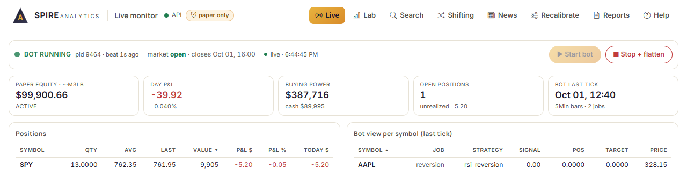
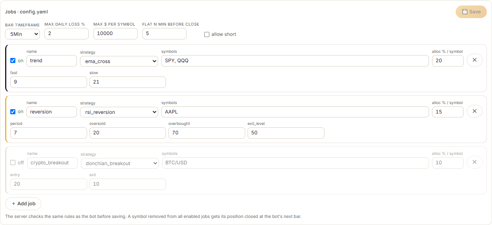
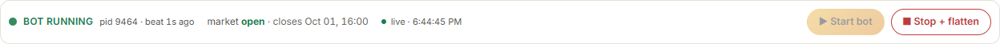
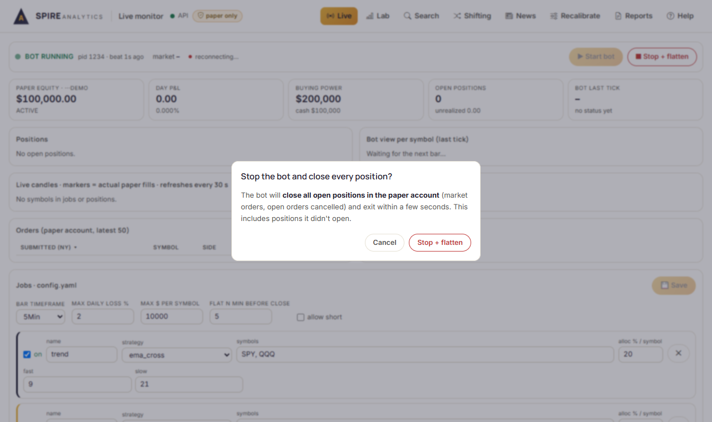
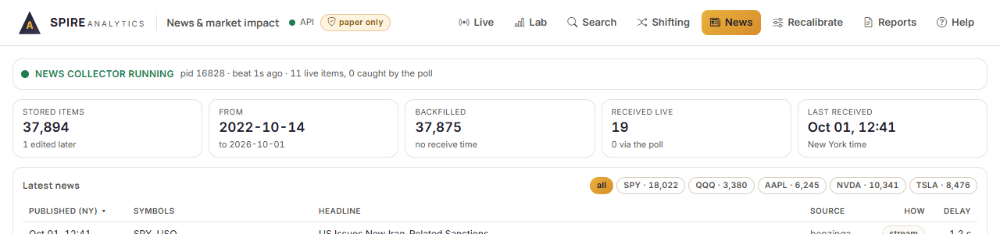
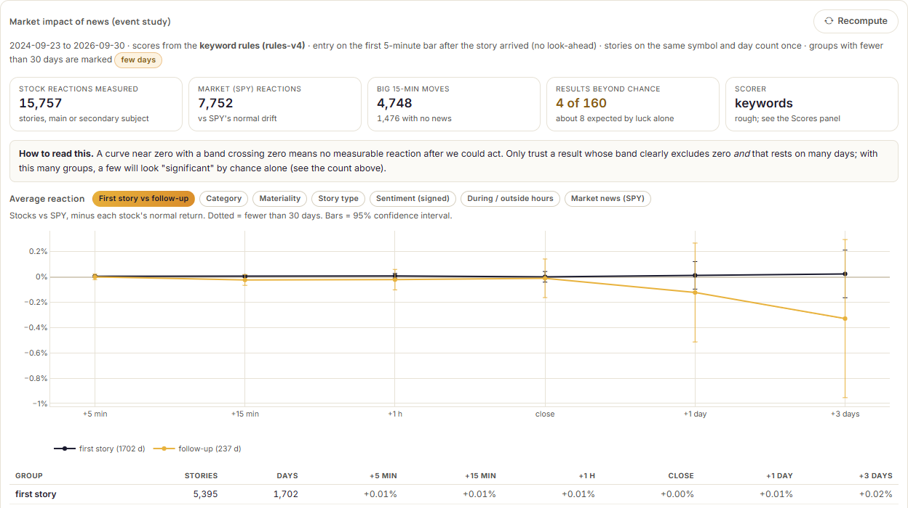
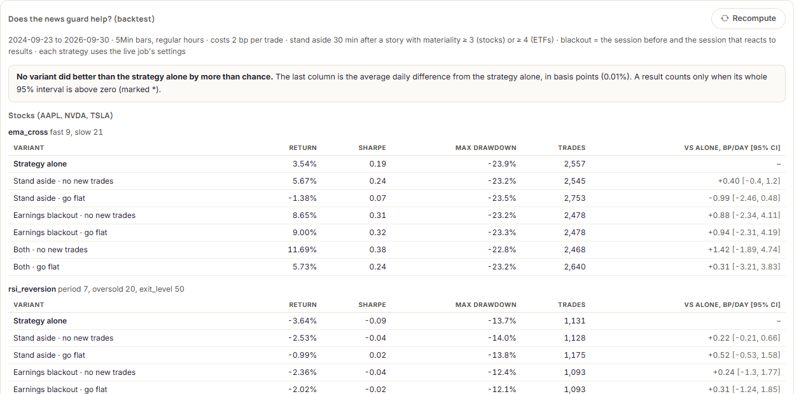
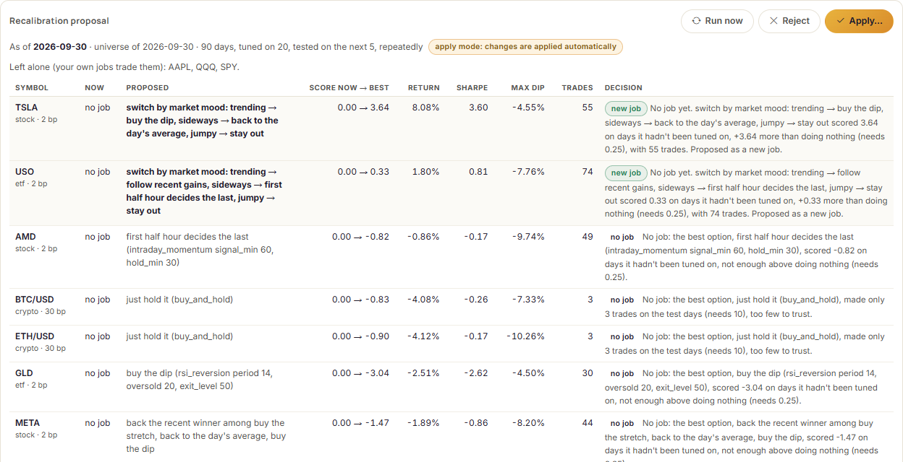

# Operating procedure: Spire Analytics paper-trading bot

Version generated 01 October 2026 18:45 (Skopje) from the bot's code and config.yaml. If something here disagrees with the app, regenerate this document (see the end).

## 1. What the bot is, and what it isn't

- It trades a **paper account** at Alpaca: pretend money, real market prices. The code is hard-wired to paper trading; there is no switch to real money.
- It follows **jobs**: each job is one strategy on one or more symbols with a share of the account. It checks the market once per 5Min bar and sends market orders. Every night it re-checks which strategy each symbol should use and changes the jobs itself when something is clearly better (section 7).
- It protects itself: if the account is down 2.0% in a day it sells everything and stops for the day; no single symbol gets more than $10,000; stock positions are closed 5 minutes before the US close.
- It writes down why it acted (logs/decisions.jsonl) and produces a plain-English report after every trading day.

**What it can't do**

- It can't predict the market or guarantee a profit. Every strategy loses in some markets.
- It doesn't trade on the news: its strategies only see prices. A separate news collector saves stories so the daily report can show them (section 6).
- It can't trade while the PC is off, asleep or offline, and it can't fix a broken internet connection.
- Market orders fill at the best available price, which can differ from the last price it saw, especially at the open and in fast markets.
- It never trades real money, and results on paper can be better than real trading would be.

## 2. Before the market opens

The US market opens at 09:30 New York time, which is usually **15:30** in Skopje (see the table in section 4 for the weeks when it differs).

1. Switch the PC on and make sure it won't sleep: Windows Settings → System → Power → *Sleep* = **Never** (when plugged in). The bot stops trading if the PC sleeps.
2. Double-click **start_lab.bat** in E:\autobot. Two windows open ("autobot API" and "autobot web") and the lab opens in the browser at http://127.0.0.1:5190. Leave both windows open all day.
3. Open the **Live** page. Check the small dot next to *live* is **green** (connected) and the header says **API** with a green dot and **paper only**.
4. Check *Paper equity* shows a dollar amount and the account status is ACTIVE.
5. Scroll to **Jobs · config.yaml** and check which jobs are switched **on** and on which symbols (below). Change nothing on the day unless it was tested in the Lab first.

*The Live page when everything is connected: green dots next to API and live, the paper-only badge, the account figures.*

| Job | On? | Strategy | Symbols | Share of account per symbol |
|---|---|---|---|---|
| trend | on | ema_cross (follow the trend) | SPY, QQQ | 20% |
| reversion | on | rsi_reversion (buy the dip) | AAPL | 15% |
| crypto_breakout | off | donchian_breakout (buy the breakout) | BTC/USD | 10% |

*The Jobs editor. Switch a job on or off with its checkbox, then Save. The bot applies saved changes at its next bar.*

### Automatic start (optional)

The bot and the lab can start by themselves 2 minutes after you log on to Windows (Task Scheduler tasks **Spire autobot** and **Spire autobot lab**). Turn it on with **autostart_on.bat** and off with **autostart_off.bat** in E:\autobot; turning it off doesn't stop anything already running. Started this way, a supervisor restarts the bot after a crash (at most 3 times an hour) and writes each crash to logs/bot.log. If a bot is already running, a second one exits quietly.

## 3. Starting the bot

1. On the **Live** page press **▶ Start bot** (top right), or double-click **start_bot.bat** (this one also restarts the bot after a crash).
2. Within a few seconds the status changes to **BOT RUNNING** with a green dot, a process number (pid) and *beat 1s ago*. The beat number must stay small (under 10 seconds).
3. Wait for the first tick: within one 5Min bar, *Bot last tick* shows the current time and the *Bot view per symbol* table fills in.
4. If Start is greyed out, a bot is already running (or a stuck one is still alive, shown as *unresponsive*). Never start a second bot.

*What 'running' looks like: BOT RUNNING, the pid, and a heartbeat a second or two old.*

## 4. Stopping the bot

### Normal stop

1. Live page → **⏹ Stop + flatten** (or double-click **stop_bot.bat**).
2. Read the confirmation and press **Stop + flatten**. The bot closes **every** open position in the paper account (including ones it didn't open) and exits within a few seconds.
3. Confirm all is flat (see below).

*The confirmation dialog. Cancel changes nothing.*

### Emergency stop

1. If the page doesn't respond: create an empty file named **STOP** (no extension) in E:\autobot. In PowerShell: `New-Item E:\autobot\STOP`. The bot checks for it every few seconds, closes everything and exits; if the bot is stuck, its watchdog does the same within about 10 seconds.
2. If that doesn't work within a minute: on the Alpaca website (paper account) → Positions → **Close all positions**, then end the *python … live.py* process in Task Manager.

### Automatic close-of-day flatten

The bot closes all stock positions 5 minutes before the US close (15:55 New York). That is usually **21:55** in Skopje, but it shifts for a few weeks when the US and Europe change their clocks on different dates:

| Dates in 2026 | Close-of-day flatten, Skopje time |
|---|---|
| 01 Jan to 07 Mar | 21:55 |
| 08 Mar to 28 Mar | 20:55 |
| 29 Mar to 24 Oct | 21:55 |
| 25 Oct to 31 Oct | 20:55 |
| 01 Nov to 31 Dec | 21:55 |

### How to confirm all is flat

- Live page → **Positions** says *No open positions*.
- The Alpaca website (paper account) shows no positions and no open orders.
- The status shows **BOT STOPPED** (unless you intend it to keep running).

## 5. The strategies in plain words

### Benchmark

**Just hold it** (`buy_and_hold`)

- Buy once and keep holding. It is the yardstick every other strategy must beat.
- **Likes:** Markets that rise steadily.
- **Hates:** Long falls: it never steps aside.
- **Typical behaviour:** No trading at all; it simply follows the market up and down.

### Trend following

**Follow the trend (slow)** (`sma_cross`)

- Own the stock while its short-term average price is above its long-term average.
- **Likes:** Long, steady trends.
- **Hates:** Choppy, sideways markets where the averages keep crossing.
- **Typical behaviour:** Many small losses while waiting, a few big wins when a trend runs.

**Follow the trend** (`ema_cross`)

- Own the stock while its fast-reacting average price is above its slower average.
- **Likes:** Clear up-trends.
- **Hates:** Sideways markets: it buys late and sells late, again and again.
- **Typical behaviour:** Many small losses, few big wins. Reacts a little faster than the slow version.

**Ride the momentum** (`macd`)

- Own the stock while its upward momentum is strengthening (MACD above its signal line).
- **Likes:** Markets that speed up in one direction.
- **Hates:** Flat, jittery markets.
- **Typical behaviour:** Trades often; small losses in noise, gains when momentum builds.

**Follow recent gains** (`momentum`)

- Own the stock while it is up over the last N bars.
- **Likes:** Persistent trends.
- **Hates:** Sudden reversals.
- **Typical behaviour:** Stays in during trends, gives some back when the trend turns.

### Buy the dip / mean reversion

**Buy the dip** (`rsi_reversion`)

- Buy after a sharp short-term drop (RSI very low) and sell once the price has recovered.
- **Likes:** Calm, sideways markets that bounce back.
- **Hates:** Strong down-trends, where a dip keeps dipping.
- **Typical behaviour:** Many small wins, occasional larger losses.

**Buy the stretch** (`bollinger_reversion`)

- Buy when the price falls unusually far below its recent average and sell when it returns to the average.
- **Likes:** Calm markets that swing around an average.
- **Hates:** Breakouts and crashes that keep going.
- **Typical behaviour:** Frequent small wins, rare large losses.

**Buy the dip in an uptrend** (`connors_rsi2`)

- In a long-term uptrend (price above its 200-bar average), buy very short, sharp dips and sell on the bounce.
- **Likes:** Rising markets with brief pullbacks.
- **Hates:** Bear markets (it simply stays out).
- **Typical behaviour:** High win rate, small average gain; designed for daily bars.

**Buy the weak close** (`ibs_reversion`)

- Buy when a bar closes near its low and sell when a bar closes near its high.
- **Likes:** Index funds in calm markets.
- **Hates:** Trending sell-offs.
- **Typical behaviour:** Short holding times, many small trades; designed for daily bars.

### Breakout

**Buy the breakout** (`donchian_breakout`)

- Buy when the price makes a new high for the last N bars; sell on a new N-bar low.
- **Likes:** Strong moves that break out of a range.
- **Hates:** Fake breakouts in sideways markets.
- **Typical behaviour:** Low win rate, but the winners can be large.

### Intraday (flat every night)

**Back to the day's average** (`vwap_reversion`)

- Buy when the price is well below the day's volume-weighted average price and sell when it gets back to it.
- **Likes:** Quiet trading days.
- **Hates:** Days with a strong one-way move.
- **Typical behaviour:** Small, frequent trades within the day.

**Trade the opening break** (`opening_range_breakout`)

- Watch the first minutes of the day, then trade in the direction the price breaks out of that range; flat by the close.
- **Likes:** Days with a clear direction early on.
- **Hates:** Days that chop back and forth.
- **Typical behaviour:** One or two trades a day, never held overnight.

**First half hour decides the last** (`intraday_momentum`)

- If the market rose in the first half hour, hold it in the last half hour (and the reverse).
- **Likes:** Busy, news-driven days.
- **Hates:** Quiet days with no follow-through.
- **Typical behaviour:** At most one short trade near the close each day.

**Break out of the usual noise** (`noise_area`)

- Only trade when the price moves further from the open than it normally does at that time of day; exit on a trailing stop; flat by the close.
- **Likes:** Strong trending days.
- **Hates:** Range-bound days.
- **Typical behaviour:** Few trades, sits out most of the day.

### Strategy shifting

**Switch by market mood** (`regime_switch`)

- Decide whether the market is trending, calm or jumpy, and hand control to the strategy chosen for that mood.
- **Likes:** Markets that stay in one mood for a while.
- **Hates:** Markets that flip mood constantly (switching costs).
- **Typical behaviour:** Behaves like whichever strategy is in charge; stays flat when the market is jumpy if set to.

**Back the recent winner** (`perf_rotation`)

- Every few bars, give control to the strategy that has done best recently.
- **Likes:** Periods where one style keeps working.
- **Hates:** Markets where yesterday's winner is today's loser.
- **Typical behaviour:** Switches now and then; can sit flat when everything has been losing.

**Majority vote** (`ensemble_vote`)

- Ask several strategies and only take the position most of them agree on.
- **Likes:** Clear markets where signals agree.
- **Hates:** Mixed markets, where it mostly stays out.
- **Typical behaviour:** Fewer trades than any single strategy, smoother results.

### News-aware

**Step aside for news** (`news_guard`)

- Runs another strategy, but takes no new position for a while after an important news story on the stock, and around its earnings releases.
- **Likes:** Markets where news days bring sudden, unpredictable swings.
- **Hates:** Stocks whose best moves happen right after news.
- **Typical behaviour:** Fewer trades on news and earnings days; otherwise identical to the strategy it wraps.

### Market moods (regimes)

**A strong trend** (`trend`)

- The price is moving steadily in one direction (trend strength above its threshold).

**A calm, sideways market** (`range`)

- No strong direction: the price moves back and forth.

**A jumpy, high-volatility market** (`high_vol`)

- Price swings are much bigger than usual for this stock.

**Not enough history yet** (`warmup`)

- The bot needs more past prices before it can judge the market.

### Shifting methods

**Switch by market mood** (`regime_switch`)

- Each bar the bot labels the market trending, sideways or jumpy, then uses the strategy you chose for that label. A new mood must last a few bars before the bot switches, to avoid flip-flopping.

**Back the recent winner** (`perf_rotation`)

- Every K bars the bot checks which of the chosen strategies has done best over the last N bars and hands it control. If all have been losing it can stay out.

**Majority vote** (`ensemble_vote`)

- The bot asks every chosen strategy for its position and follows the majority; with 'average' it takes a partial position in proportion to the votes.

## 6. News and earnings

A separate program, the **news collector**, saves every Alpaca/Benzinga news story about SPY, QQQ, AAPL, NVDA, TSLA to data/news.db. It starts with start_lab.bat (window *autobot news*) or on its own with **start_news.bat**. It never trades, and the bot trades the same whether it runs or not; it only feeds the news sections of the reports and the News page.

### Checking it runs

- News page, top line: a green dot and *news collector running*, with a beat a few seconds old.
- *Last received* shows a recent New York time while the market is open (stories arrive every few minutes on a normal day).
- The daily report warns under *Things to watch* if the collector wasn't receiving stories live that day.

*The top of the News page: collector status and the story counts.*

### What the reports show

- **News on our symbols**: for each symbol, the number of material stories, up to 5 headlines, whether it was an earnings day, and the day's biggest 15-minute move with whether a story arrived in the hour before it. That is timing only: it does not mean the story caused the move.
- **News near a trade**: when a material story arrived up to 60 minutes before a buy or sell, the trade's sentence names it and says it is context only.
- Small diamonds above the price charts mark material stories.
- **Things to watch** lists the earnings dates in the next 7 days that are listed in config.yaml.

### What the scores mean

Every story gets a **materiality** score from 1 (routine) to 5 (major) and a category (earnings, analyst rating, macro …). Reports show stories at materiality 3 or more for companies and 4 or more for index funds (SPY, QQQ), because general market news names the index funds all day. The scores come from fixed **keyword rules** (rules-v4), which are rough and sometimes misfile a story. Claude (prompt v4) scored only a sample; scoring more costs money and is started from the News page, which shows the cost first.

### What we found

- On days with news, prices moved **10-36% more than usual** by the close (stories on analyst ratings, guidance, the economy and other news).
- Whether a story sounded good or bad **did not tell which way the price would go**: 0 of 12 measurements were beyond chance, no more than luck alone gives.
- After a big 15-minute move, the price kept going by the close 49% of the time with news and 49% without: about a coin flip either way.
- Pausing trading around news (the *step aside for news* strategy) **did not do better than the strategy alone** beyond chance in a backtest from 2024-09-23 to 2026-09-30, and going flat around index-fund news did slightly worse. No live job uses it.

From the news studies on the News page (2024-09-23 to 2026-09-30); this list is rebuilt from their latest results each time this document is generated.

*The event study on the News page: how prices moved after news, with 95% ranges.*

*The news-guard backtest: each variant against the strategy alone.*

### Earnings dates

Prices often move more around a company's quarterly results. The reports, and the earnings pause in the *step aside for news* strategy, use the dates listed in config.yaml under `news: earnings_dates`; after the last listed date, dates found in the news fill in. The news alone can't be relied on to find them (it found 17 of 21 correctly in a check).

| Symbol | Last listed date | Next listed date |
|---|---|---|
| AAPL | 2026-05-01 | **none: add it when announced** |
| NVDA | 2026-05-21 | **none: add it when announced** |
| TSLA | 2026-04-23 | **none: add it when announced** |

1. When a company announces its next results date (its investor-relations page or the news), work out the session that reacts: the same day if results come before the open, the **next trading day** if they come after the close (most do).
2. Open config.yaml in E:\autobot with Notepad and add the date under the symbol, in the same format: `- 'YYYY-MM-DD'`.
3. Save. Reports pick it up at the next run; the bot doesn't need a restart. Saving jobs in the lab keeps these dates.

## 7. Automatic strategy selection

Every night after the close the bot re-checks which strategy each symbol should trade. **It changes the jobs itself** (mode *apply*). Every symbol on the trading list is managed this way, including those that had hand-made jobs.

### The trading list (universe)

Every 7 days the bot ranks the candidates of each group on how much they trade and how much they move (the last 20 trading days):

| Group | How many | Candidates |
|---|---|---|
| tech | 5-6 | NVDA, AAPL, MSFT, AMZN, META, TSLA, AMD |
| index etf | 2 | QQQ, SPY |
| commodity etf | 2-3 | USO, GLD, SLV |
| crypto | 1-2 | BTC/USD, ETH/USD |

A symbol already on the list stays until it drops more than 2 places below the cut, so the list doesn't change for small moves. The trading figures come from the free IEX feed, which sees only part of the market: they are only used to compare symbols with each other.

### The nightly check (recalibration)

1. For each symbol, every strategy and setting is tested on the last 90 days in turns: tuned on 20 days, then tried on the next 5 days it had not seen. Costs are included (2 bp a trade for stocks, 30 bp for crypto), and stocks are sold before the close, like the bot does.
2. It also builds 'switch by market mood' and 'back the recent winner' combinations from the best 3 strategies.
3. Each option gets a score from the test days only (Sharpe, return, deepest dip and trading). Doing nothing scores 0.
4. A new strategy replaces the current one only if it scores at least 0.25 better, made 10+ trades, the current one has been in place 5+ days, and the symbol hasn't already changed 1 time in the last 7 days. A symbol where nothing beats doing nothing gets no job.

Every decision has a plain-English reason, shown on the Recalibrate page and in the next daily report (*Strategy changes*).

*The Recalibrate page: current and proposed strategy per symbol, the scores on unseen days, and the reason.*

### When changes take effect

- Stock jobs change only while the market is closed (the bot holds no stocks overnight), so a change starts at the next open.
- A crypto job changes only when the bot holds none of that coin; until then it shows as *waiting to apply*.
- The new settings are checked first; if they fail, nothing is written. A copy of the old config.yaml is kept in data\recalibration\config_backups.
- A symbol that leaves every job has its position closed by the bot.

### Position size

**Now: fixed.** Each symbol gets its job's share of the account, at most $10,000. The other mode is available in config.yaml (`risk: sizing`); compare it in the Lab first.

### Profit lock

**Off.** When switched on (`risk: profit_lock: enabled: true`), once the day's gain reaches 1.5%, a fall of more than 50% from the day's best makes the bot sell everything and stop for the day. The Lab page (*Account rules*) shows what it would have done on recent prices.

## 8. What to watch: daily checklist

Look at the Live page a few times a day and read the daily report after the close. 🟢 green = fine, 🟠 amber = keep an eye on it, 🔴 red = act now.

| Check | Green | Amber | Red: what to do |
|---|---|---|---|
| Day P&L vs the daily loss limit | above -1% | -1% to -1.6% | below -1.6% or the bot halted: the limit (2.0%) will stop it; don't restart it the same day |
| Deepest dip this week (weekly report) | less than 2% | 2% to 4% | more than 4%: review the strategies (section 10) |
| Number of trades vs a normal day | similar to the last 5 reports | twice as many or none at all | many times more: check the log and the jobs; stop the bot if unsure |
| Errors in the bot log (Live page) | none | an occasional data error (the bot skips that bar) | errors every bar, or CRITICAL/WATCHDOG lines: see troubleshooting |
| Last tick / heartbeat | last tick within one 5Min bar; beat under 10 s | last tick 1-3 bars old | heartbeat over 90 s, status 'unresponsive', or last tick more than 3 bars old: stop and restart |
| Strategy switching (reports, Shifting jobs) | 0-4 switches a day per symbol | 5-8 a day | more than 8 a day: switching costs money; test a larger confirm_bars in the Lab |
| A symbol stuck in a position | positions change when signals change | an intraday strategy still holding late in the day | a position held with no job on that symbol: close it on the Live page or the Alpaca website |
| Nightly strategy check (Recalibrate page) | the proposal date is the last trading day; status applied (or nothing to change) | items *waiting to apply* for more than a day (a coin position that never closes) | *Last automatic run failed*: read the message; the bot keeps yesterday's jobs. Press Run now once the cause is fixed |
| News collector (News page, top) | *news collector running*, last story received within the hour during market hours | nothing received for 1-2 hours while the market is open | *stopped*, or the daily report says it wasn't receiving stories live: double-click **start_news.bat** (trading isn't affected) |

## 9. Troubleshooting

| Symptom | Likely cause | What to do |
|---|---|---|
| Header shows **API down** | The 'autobot API' window was closed or crashed | Run start_lab.bat again. The bot keeps running on its own; check it on the Live page. |
| Live page says *reconnecting…* | The API is restarting or not running | Wait 10 seconds; if it stays, run start_lab.bat. |
| Status **unresponsive** | The bot process is alive but hasn't beaten for 90 s (stuck) | Press Stop + flatten. If nothing happens within a minute, use the emergency stop. The watchdog also exits a bot stuck for 300 s. |
| Bot stopped by itself | Daily loss limit, a stall, or the PC slept | Read the bot log tail on the Live page (look for FLATTEN, WATCHDOG, CRITICAL). Restart only if you understand why. |
| **Start** refused: 'already running' | A bot is still running | Don't start another. Stop the running one first if needed. |
| Jobs editor won't save | A rule was broken (message in red), e.g. one symbol in two jobs | Fix what the message says, then Save. |
| No orders all day | Market closed, signals said 'stay out', or the allocation buys less than 1 share | Check the Bot view per symbol table (signal and target) and the reasons in the daily report. |
| Report says *reason not recorded* | The trade happened while an older bot version without the decision log was running | Nothing to fix; new trades will have reasons. |
| No daily report | The lab wasn't running 10 minutes after the close | Reports page → pick the date → Generate. |
| 'data/signal error' lines in the log | Internet or Alpaca data problem | The bot skips those bars. If it lasts, check your connection and Alpaca's status page. |
| News page says *news collector stopped* | The 'autobot news' window was closed, or the PC slept | Double-click **start_news.bat**. It fills in the stories it missed, then collects live again. Trading is not affected. |
| Report's news section says *No news database yet* | The news collector has never run on this PC | Double-click **start_news.bat** and leave it running; the first start downloads two years of stories (a few minutes). |
| Report says a story was 'filled in afterwards' | The collector wasn't running live that day; it caught up later | Nothing to fix for that day; keep the 'autobot news' window open on trading days. |
| A symbol from the trading list has no job | On the test days nothing beat doing nothing (or too few trades) | Nothing to fix: the reason is on the Recalibrate page. It is re-checked every night. |
| You want to undo a strategy change | The nightly check switched a job you preferred | Copy the newest file from data\recalibration\config_backups over config.yaml (the bot uses it from its next bar), then set `recalibration: mode: propose` so it isn't changed again tonight without your Apply. |
| Account result in a report looks far too big | The broker's history counted a deposit (it does this in a paper account's first days) | The report leaves out jumps over 10% in 5 minutes and says so in a note at the top; if there is no note, check the Alpaca website. |

## 10. Weekly review

1. Reports page → **Last 7 days**. Read the headline, then the charts.
2. Check: the result against simply holding SPY, the number of trades, the worst trade, the deepest dip, and the 'What didn't' list.
3. Compare with the last few weeks' reports; one bad week alone says little.
4. Earnings dates: if a company we trade has announced its next results date, add it to config.yaml (section 6, *Earnings dates*).
5. Recalibrate page: how many strategy changes happened this week and why (the reasons are on the page and in the daily reports). Several changes on the same symbol week after week means no strategy works well there; consider leaving it out of the trading list.

**When to change or switch off a strategy**

- It trailed simply holding SPY for three weeks in a row while trading a lot.
- Its deepest dip in a week was more than 4%.
- The report keeps saying 'many small losses in a sideways market' for a trend strategy (or the reverse for a dip-buying strategy).
- It switches strategies more than 8 times a day on a symbol, week after week.

> Always test a change in the Lab first: Lab → run it on Alpaca data (at least 90 days), then Search → Walk-forward. Only change the live job if the walk-forward result is better than what runs today. Change one thing at a time, and note the date so the reports can be compared.

## Keeping this document up to date

Run `python scripts/build_sop.py --shots` with the lab running. It re-reads the strategies, limits, jobs and times, takes fresh screenshots and rebuilds this document (Markdown, HTML and PDF).
